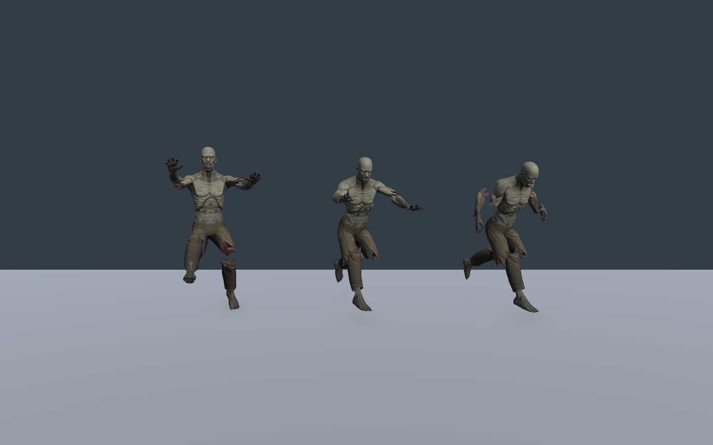
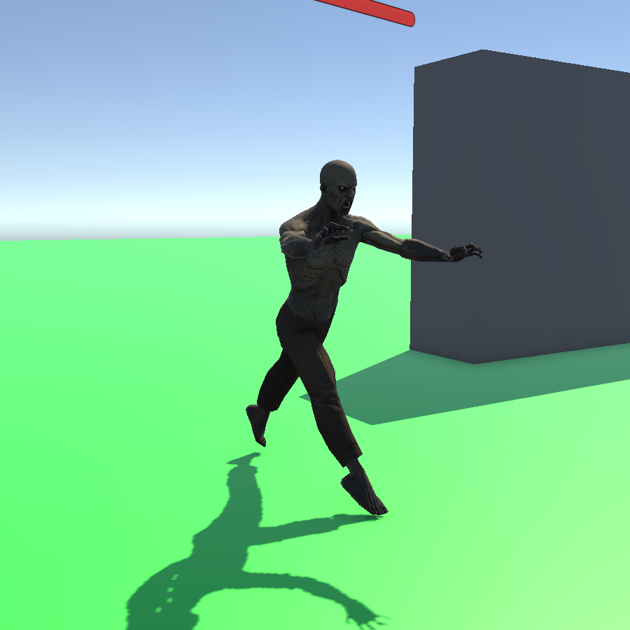

# 좀비 Run 하체 합성 조사와 수정

## 기존 적용 방식

1. `Y Bot@Injured Run.fbx`의 Humanoid 클립을 복제해 `Z_InjuredRun_Legs.anim`을 만들고 Loop Time을 켰다. 원본 FBX는 수정하지 않았다.
2. `Zombie_AI.controller`의 Base Layer에는 기존 `Z_Run_InPlace.anim`을 유지했다.
3. `Injured Run Legs` Override 레이어를 Weight 1로 추가하고 양쪽 다리·발 IK만 활성화한 `ZombieInjuredLegs.mask`를 연결했다. Run에서만 부상 달리기를 사용했다.
4. 처음에는 Sync를 켰으므로 약 0.633초인 하체가 기존 Run의 약 1.533초 주기로 늘어났다. 이후 Sync를 해제하고 같은 상태·전환 조건의 별도 상태 머신으로 변경했다. 현재 두 레이어는 각각 원래 주기로 재생한다.

Unity의 부분 애니메이션 합성 방식은 **레이어 + Avatar Mask + Override**다. 이 선택 자체는 맞았다. 그러나 골반까지 고려하지 않은 마스크 구성이 이 프로젝트에서 문제였다. [Animation Layers](https://docs.unity3d.com/6000.0/Documentation/Manual/AnimationLayers.html), [Avatar Mask](https://docs.unity3d.com/6000.0/Documentation/Manual/class-AvatarMask.html)

## 조사와 원인 확인

Humanoid의 `Body`는 Hips·Spine·Chest를 함께 포함한다. 다리 그룹만 켜면 골반은 제외된다. Unity의 근육 곡선과 손·발 IK 목표는 Body Transform을 기준으로 저장되므로, 같은 다리 회전도 다른 골반 자세 밑에서는 다른 발 위치가 된다. [AvatarMaskBodyPart 소스](https://github.com/Unity-Technologies/UnityCsReference/blob/master/Modules/Animation/ScriptBindings/AvatarMask.bindings.cs), [How Root Motion works](https://docs.unity3d.com/6000.0/Documentation/Manual/RootMotion.html)

Y Bot 체형과 좀비 체형을 직접 비교하지 않고, 같은 좀비 아바타에 아래 조건을 적용했다.

- 기존 다리·발 IK 마스크.
- 발 IK 마스크만 끈 조건.
- Root만 추가한 조건.
- Root와 Body를 함께 추가한 조건.
- Injured Run을 전신에 적용한 기준 모델.

8개 시점(정규화 시간 0, 0.125, …, 0.875)에서 기존 합성의 다리 로컬 회전은 기준 모델과 같았지만 골반 로컬 회전은 약 30~41도 달랐다. 발 IK 마스크만 끄는 것으로는 개선되지 않았다. 이는 이번 문제의 주원인이 골반·몸통의 기준 불일치라는 판단을 뒷받침한다.

## 수정 결과

`ZombieInjuredLegs.mask`에 **Root와 Body를 추가**했다. 활성 영역은 Root, Body, LeftLeg, RightLeg, LeftFootIK, RightFootIK다.

- 골반·척추·가슴·다리는 Injured Run을 따른다.
- 머리·팔·손은 기존 좀비 Run을 따른다.
- 따라서 이제는 엄밀히 “다리만 교체”가 아니라 **골반·몸통을 포함한 보행 합성**이다. Body를 켜면 척추·가슴도 바뀐다는 점을 명시한다.
- `Animator.applyRootMotion`은 false다. 마스크의 Root와 루트 모션 이동 적용은 별도 설정이다. 이동·점프 위치는 기존 NavMesh/점프 코드가 제어한다.
- Idle, Walk, Attack, Hit, Death에는 하체 레이어에서도 각각 기존 클립을 사용한다.

| 같은 좀비 아바타·8개 시점 기준 | 수정 전 | 수정 후 |
| --- | ---: | ---: |
| 원본 대비 골반 로컬 회전 차이 | 29.8~41.1도 | 2.8~5.3도 |
| 원본 대비 양발 위치 평균 차이 | 약 65.6cm | 약 3.0cm |
| 원본 대비 양발 위치 최대 차이 | 약 81.6cm | 약 5.8cm |
| 기존 합성 대비 머리·양쪽 위팔 로컬 회전 차이 | — | 0도 |

발 위치는 모델 루트 위치를 뺀 3차원 상대 위치로 비교했다. 지면 관통 깊이나 모든 프레임의 최대 오차가 아니다. 표는 위 8개 시점의 결과이며, 다른 상체를 유지한 합성이 전신 원본과 완전히 같다는 의미는 아니다.

아래 그림은 왼쪽부터 **수정 전 / 수정 후 / Injured Run 전신 기준**이다.

## 실행 확인

실제 Play의 NavMesh 추적을 약 0.1초 간격으로 10프레임 촬영했다. `Trace`, 속도 약 5, 두 레이어의 Run 재생, 루트 모션 비활성화를 확인했다. 기록된 하체 정규화 시간은 약 0.162→1.620으로 진행해 반복 경계를 통과했다. 상체 약 1.533초·하체 약 0.633초의 주기도 기록과 일치했다.

별도 Preview Scene에서 Idle/Walk/Attack/Hit/Death의 중간 자세를 기존 Base Layer 단독 결과와 비교했다. 해당 시점의 뼈 위치·회전 차이는 0이었다. Speed 5→Run, Attack, Hit, Dead 전환도 양쪽 레이어에서 확인했다. 전 지형·모든 전환 프레임의 검증을 의미하지 않는다.

진단 모델은 Preview Scene 종료 시 제거했고 촬영 카메라도 자동 제거했다. 메인 카메라·HUD는 촬영을 위해 변경하지 않았다. 임시로 해제한 Play 일시정지 상태는 복구했다.

측정 기록: [포즈 비교](ZombieRunEvidence/metrics.json), [추적 기록](ZombieRunEvidence/chase.json), [상태·전환 확인](ZombieRunEvidence/states.json).

## 관련 문제와 유지보수 기준

| 문제 | 현재 처리와 한계 |
| --- | --- |
| Sync에 따른 속도 변경 | Sync를 끄고 두 클립을 각각 원래 주기로 재생한다. |
| 골반과 다리의 다른 기준 | Root + Body + Legs를 같은 보행 클립에서 가져오도록 수정했다. |
| 발 IK | 이번 비교에서 IK 마스크만 끄는 것으로는 개선되지 않았다. IK Pass나 Foot IK를 무조건 켜는 처방을 적용하지 않았다. |
| NavMesh와 루트 모션 충돌 | 루트 모션 이동을 끄고 NavMesh가 위치를 제어한다. |
| 발 미끄러짐 | 제자리 달리기와 이동 속도가 다르면 발생할 수 있다. 이 클립의 averageSpeed는 약 0.035로 실제 보행 속도를 나타내지 않으므로 이를 이용한 자동 속도 계산은 적용하지 않았다. 완전한 지면 고정·경사면 발 IK는 별도 작업이다. |
| 반복 경계 | Loop Time을 켰으며 원본 자세를 유지하려고 Loop Pose는 껐다. 원본 시작·끝 곡선은 완전히 같지 않다. 실제 반복 경계 통과를 촬영했지만 모든 조건에서 미세한 튐이 없다고 보장하지 않는다. |
| 리타게팅 | 두 아바타는 유효한 Humanoid이고 비교는 같은 좀비 아바타로 진행했다. 다른 체형에서는 결과가 달라질 수 있다. |
| 상태 머신 이중 관리 | 하체는 기존 전환 조건·순서를 복제한 별도 상태 머신이다. 이후 상태·전환 수정 시 두 레이어에 함께 반영해야 한다. |
| 풀 재사용 | 기존 `ZombieAnimation.ResetAnimation`의 두 레이어 Idle 초기화 및 Attack/Hit 트리거 취소를 유지했다. 전체 생성·사망 반복은 이번 실플레이 검증 범위에 포함하지 않았다. |

Unity는 NavMesh와 루트 모션이 동시에 위치를 제어하지 않도록 한 방향으로 연결할 것을 권장한다. Agent가 이동을 주도하면 모션과 속도가 다를 때 발 미끄러짐이 생길 수 있다. 반복 모션은 시작·끝 자세도 맞아야 한다. [NavMesh Agent와 다른 컴포넌트](https://docs.unity3d.com/2019.4/Documentation/Manual/nav-MixingComponents.html), [Loop optimization](https://docs.unity3d.com/6000.0/Documentation/Manual/LoopingAnimationClips.html)
